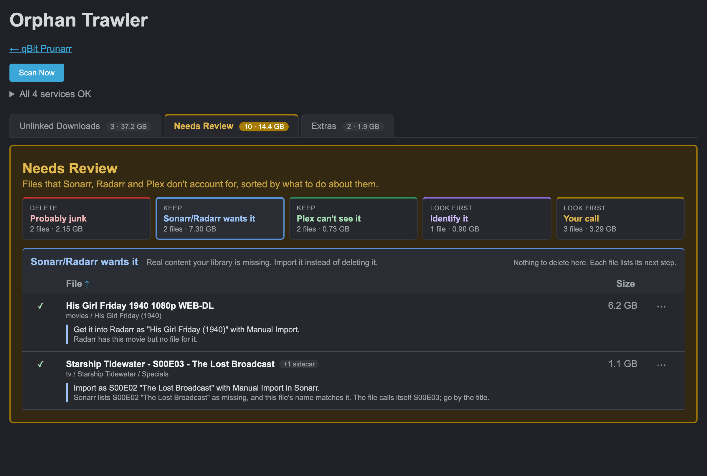
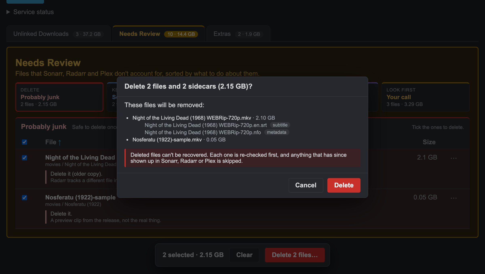
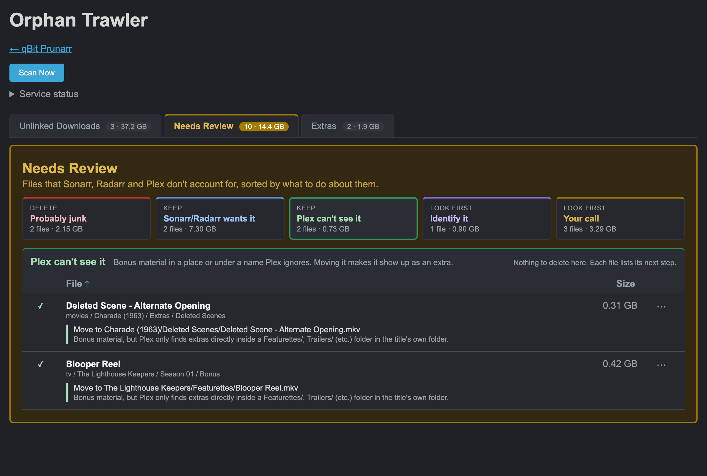
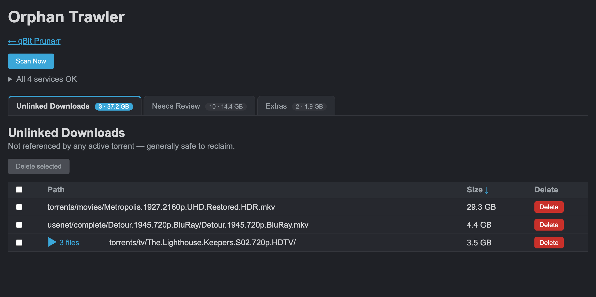
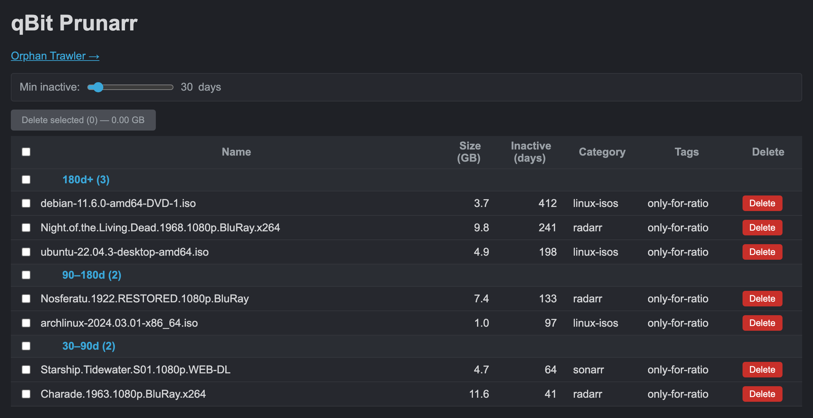

# qbit-prunarr

Finds the files in your media library that Sonarr, Radarr and Plex have lost track of, and tells you what to do with each one: delete it, import it, move it where Plex can see it, or look at it first.



Scanning never changes anything. Nothing is deleted unless you ticked it, read the list of exactly what's going, and it passed a fresh re-check first.

## Try it in 30 seconds

No NAS, no API keys. The demo builds a made-up library (public-domain films, invented TV shows, sparse files that take no disk space) and fake qBittorrent, Sonarr, Radarr and Plex APIs, then runs the real app against them:

```
git clone https://github.com/MikeTheCanuck/qbit-prunarr && cd qbit-prunarr/app
python3 -m venv .venv && .venv/bin/pip install -r requirements.txt
.venv/bin/python demo.py
```

Open `http://localhost:8585/orphans` and press **Scan Now**. Deletes are real but only touch the sandbox, which is rebuilt every time the demo starts.

## What it does

1. **Needs Review** (the main event). Media files that aren't confirmed by *both* Sonarr/Radarr *and* Plex, each with a verdict: probably junk (samples, older copies Radarr replaced), Sonarr/Radarr wants it (a missing special, a movie Radarr has no file for), Plex can't see it (bonus material in the wrong folder), identify it, or your call.
2. **Unlinked Downloads.** Download-side files no torrent, \*arr queue or library hardlink claims.
3. **Cold torrents.** qBittorrent torrents with a given tag (`only-for-ratio` by default) that haven't seen activity in N days, bucketed by age.

| | |
|---|---|
|  |  |
|  |  |

It works with exactly one stack: qBittorrent, Sonarr, Radarr and Plex, in Docker on a Synology NAS, with the \*arrs importing downloads as hardlinks (see [Before you start](#before-you-start)). It calls those four apps' APIs directly. Other download clients (Transmission, Deluge, SABnzbd's own history), other media servers (Jellyfin, Emby) and the other \*arrs (Lidarr, Readarr) aren't supported and haven't been tried. FastAPI, Jinja2 and HTMX. No JS framework, no build step.

## Why this exists

qBittorrent's WebUI has no "last activity" column and no bulk prune, so ratio-only torrents pile up quietly. Separately, years of manual imports, re-grabs and half-finished downloads leave stuff behind: a big download Radarr gave up on months ago, an old copy sitting next to the upgrade that replaced it, a folder nothing points to anymore. None of the apps involved will tell you about it, because each one only knows about what it's tracking.

## The orphan trawler

### How it decides what's an orphan

Sonarr and Radarr hardlink downloads into the media library, and the two copies have different names (release name vs. library name). Matching by filename doesn't work, so the scan groups files by **inode**:

- A file under `torrents/` or `usenet/` that shares an inode with something under `media/` is linked, which means it's fine.
- **Unlinked Downloads**: download-side files with no media link, that no qBittorrent torrent and no Sonarr/Radarr queue item claims. These are usually safe to reclaim.
- **Needs Review**: media-side files that aren't confirmed by *both* the relevant \*arr (Sonarr for TV, Radarr for movies) *and* Plex. Each one gets a verdict saying what to do with it and why. Files Plex has attached as extras (a correctly placed `Featurettes/` file, say) move to their own read-only **Extras** tab instead, since Plex alone vouches for those.

That first bullet only means something if your \*arrs hardlink on import. If they copy, see [Before you start](#before-you-start).

Synology housekeeping folders (`@eaDir`, `#recycle`) are skipped. Subtitles, `.nfo` files and artwork are kept out of Needs Review, since no \*arr ever tracks them.

### Fail closed

If a service is unreachable, or its paths don't overlap with anything on disk (the fingerprint of a wrong `*_PATH_PREFIX`), nothing that depends on it gets flagged. Failing closed makes the results smaller, which can look like a tidy library, so when any service isn't `ok` the scan opens a "This scan is incomplete" warning saying exactly which results are missing. When everything worked, the line under Scan Now just says "All 4 services OK" (click it for the per-service detail).

If one of the four isn't there at all (say you run Jellyfin instead of Plex), it shows as `unreachable` and Needs Review comes back empty rather than wrong.

### Working through Needs Review

Needs Review shows one group at a time; pick one from the cards along the top. Rows are grouped by what to do with them:

- **Probably junk**: sample clips, and older copies Radarr has replaced (Radarr never removes files it didn't import itself).
- **Sonarr/Radarr wants it** (Keep): a special that matches, by title, an episode Sonarr lists as missing (the row names the exact `S00Exx` to import it as), a movie Radarr has no file for, or the real movie when Radarr is tracking its sample.
- **Plex can't see it** (Keep): bonus material in a folder or under a name Plex ignores. The row gives the path to move it to. A file already sitting in a `Featurettes/`-style folder that Plex didn't confirm this scan just says to leave it where it is.
- **Identify it**: looks like a special, but Sonarr couldn't match it (or couldn't be checked). Watch it and work out what it is.
- **Your call**: no evidence either way.

If Plex's extras couldn't be checked this scan (Plex down, or the lookup failed), Needs Review says so at the top: some of what's there may be extras Plex already shows, and the Extras tab will be empty for the same reason.

Rows in the two Keep groups have no checkbox, so they can't be swept up in a bulk delete. If you really want one gone, it's under the row's `⋯` menu as **Delete anyway…**. Everything else is ticked and deleted from the bar at the bottom, which confirms with a list of exactly what's going. Deleting a video also deletes its sidecars in the same folder: `Film.srt`, `Film.en.srt`, `Film.nfo`, `Film-thumb.jpg`. If another video shares the name, nothing is claimed. Why there's no way to keep them is under [Assumptions and trade-offs](#assumptions-and-trade-offs).

### Deleting

Single rows, whole groups (a fully orphaned folder), or a bulk selection on Unlinked Downloads or Needs Review (Extras is read-only). Before anything is removed, the app re-runs the scan and skips anything that's no longer an orphan. Empty parent folders are pruned up to, never past, the library root. A scan takes around 15 seconds on a large library, so deletes take about that long too. The button goes orange while that runs.

### The delete log

Every file removed is logged as `DELETED <path> (<bytes>)` in the container log and, if `AUDIT_LOG` is set, appended to that file. Container logs are thrown away on every rebuild, so put the audit file on a mounted volume (see below) if you want to be able to answer "what did that delete actually remove?" next week. The banner after a bulk delete also lists exactly what went.

## Setup

### Before you start

The orphan trawler assumes the TRaSH Guides convention: torrents, usenet and the media library all live under one shared folder on one Synology volume, every container mounts that folder as a single tree, and Sonarr/Radarr import a finished torrent by *hardlinking* it into the library. One file, two names, no extra space used, and the torrent keeps seeding.

Sonarr and Radarr don't require this. They only hardlink when the download and the library are on the same filesystem *and* the container sees both through one mount (their "Use Hardlinks instead of Copy" setting, on by default). Otherwise they quietly copy the file instead, and plenty of setups run that way without knowing. Usenet downloads are moved rather than linked, so there's nothing to match there in any setup.

If your \*arrs copy instead of link, the app still runs, but:

- Nothing ever counts as linked, so every download-side file that no torrent or queue item still claims lands in Unlinked Downloads. That list mixes harmless duplicates of library files with downloads that never got imported at all, and the scan can't tell which is which. Check the library before bulk-deleting.
- Needs Review isn't affected. It checks media files against the \*arrs and Plex, not inodes.

The scan matches files by inode number alone, so `DATA_ROOT` has to be one filesystem. If `torrents/` and `media/` sit on different volumes, inode numbers can collide by chance. That only ever hides an orphan (it looks linked); it never flags a file that's in use.

To check yours: `ls -i` a movie file in the library and its source in `torrents/`. Same number means hardlinked.

### Configuration

Copy `.env.example` to `.env` and fill it in:

| Variable | What it's for |
|---|---|
| `QBIT_URL`, `QBIT_USERNAME`, `QBIT_PASSWORD` | qBittorrent WebUI |
| `QBIT_TAG` | Tag the cold-torrent page looks at. Default `only-for-ratio` |
| `SONARR_URL`, `SONARR_API_KEY` | Sonarr |
| `RADARR_URL`, `RADARR_API_KEY` | Radarr |
| `PLEX_URL`, `PLEX_TOKEN` | Plex, for the "is it in the library" half of Needs Review |
| `DATA_ROOT` | Where the shared data folder is mounted inside this container. Default `/data` |
| `QBIT_PATH_PREFIX`, `SONARR_PATH_PREFIX`, `RADARR_PATH_PREFIX`, `PLEX_PATH_PREFIX` | Each app's own path to that same shared folder (e.g. `/data`), stripped so all four can be compared |
| `AUDIT_LOG` | Optional. File to append every delete to, e.g. `/logs/deletes.log` |

The path prefixes are the part people get wrong. Every container sees the same files under its own mount point, so qBittorrent might report `/downloads/completed/x.mkv` while this app sees `/data/torrents/completed/x.mkv`. If the scan says a service is `unusable`, its prefix is the first thing to check.

The scan expects this layout under `DATA_ROOT` (the [TRaSH Guides](https://trash-guides.info/File-and-Folder-Structure/) shape):

```
torrents/   usenet/
media/movies   media/movies-no-backup   media/tv   media/tv-no-backup
```

Those folder names live in `app/main.py` (`MEDIA_SUBDIRS`, `DOWNLOAD_SUBDIRS`) if yours differ.

### Running it

On a Synology NAS (or anything with Docker), using the repo's `compose.yaml` as a starting point:

```yaml
services:
  qbit-prunarr:
    build:
      context: /volume1/docker/qbit-prunarr/app
    container_name: qbit-prunarr
    ports:
      - 8585:8585
    env_file:
      - /volume1/docker/qbit-prunarr/.env
    volumes:
      - /volume1/data:/data                       # the shared torrents + media tree
      - /volume1/docker/qbit-prunarr/logs:/logs   # for AUDIT_LOG
    restart: unless-stopped
```

The orphan trawler needs the data mount; the cold-torrent page works without it.

After changing the code, rebuild the image rather than just restarting. On Synology, Container Manager's "Clean" recreates the container from the *old* image, which looks like a deploy and isn't:

```
sudo docker compose build --no-cache && sudo docker compose up -d --force-recreate
```

Then open `http://<nas>:8585/` for cold torrents and `http://<nas>:8585/orphans` for the trawler.

### Homepage widget

`GET /api/widget` returns `{"cold_torrents": N, "wasted_gb": X}` for every torrent with the configured tag, for a [Homepage](https://gethomepage.dev) `customapi` widget:

```yaml
widget:
  type: customapi
  url: http://<nas>:8585/api/widget
  mappings:
    - field: cold_torrents
      label: Cold Torrents
    - field: wasted_gb
      label: GB Wasted
      format: float
```

## Development

```
cd app
python3 -m venv .venv && .venv/bin/pip install -r requirements-dev.txt
.venv/bin/python -m pytest -q
```

The tests mock qBittorrent, Sonarr, Radarr and Plex and build real files and hardlinks in a temp directory, so the scan and delete paths run against an actual filesystem. They don't run the page's JavaScript; selection, the group cards, the delete bar and the confirm dialog get checked by hand in a browser.

Design notes live in `docs/`.

## Assumptions and trade-offs

This app makes calls on your behalf, and some of them are bets about how *your* library is laid out. They're written down here so you can tell when one of them doesn't fit you. If something the app did surprised you, it probably traces back to one of these. Open an issue and say which one, and what your setup looks like.

It's aimed at people who want their library tidy without studying it, not at people who want a setting for every behaviour. So when a choice came down to "add an option" vs. "pick a sensible default and say so here", I picked the default. If you need one of these to be optional, an issue with your use case is how that changes.

### What gets deleted

- **Sidecars go with their video, no opt-out.** Deleting a video also deletes the subtitle, `.nfo` and artwork files in the same folder that are named after it (`Film.mkv` takes `Film.srt`, `Film.en.srt`, `Film.nfo`, `Film-thumb.jpg`). The bet is that a subtitle or poster for a video you're deleting is worthless on its own. Two guards: if another video in the folder has the same base name, nothing is claimed, and `Film.Part.2.srt` belongs to `Film.Part.2.mkv`, not to `Film.mkv`.
- **The sidecar list is worked out again at delete time.** The confirm dialog lists the sidecars that were there when you scanned. The delete itself uses a fresh scan, so a subtitle that lands in the folder between your scan and your click goes too, without having been listed. Every file removed is still logged (see [The delete log](#the-delete-log)).
- **No stop button.** Once you confirm a delete, it runs to the end. The page locks your ticks and hides Clear while it runs, so nothing on screen looks like a cancel.
- **No undo.** Files are removed directly, not moved to Synology's Recycle Bin or anywhere else. The re-check and the confirm list are the safety net.
- **Hardlinks go together.** A file with more than one name in your library is still one file on disk. Deleting it removes every one of those names (the row's `+N more` chip lists them).
- **Empty folders are cleaned up.** After a delete, parent folders left empty are removed, up to but never including the library root.

### How files get sorted

- **Your stack does the vouching.** A media file is only "accounted for" when *both* the relevant \*arr and Plex know it. If either one doesn't, it lands in Needs Review. If a service can't be reached, nothing that depends on it gets flagged ([Fail closed](#fail-closed)).
- **Only Plex can say something is an extra.** A file moves to the Extras tab only when Plex's own extras API lists it. Folder and file names (`Featurettes/`, `-trailer`) are only ever used to *suggest* where to move something, because Plex ignores some places that look right by name (an extras folder inside another extras folder, for one).
- **The groups are educated guesses.** Probably junk means "sample" in the name or folder and under 500 MB, or an older copy Radarr has already replaced. Sonarr/Radarr wants it means a special whose *title* matches a missing Sonarr episode (the file's own `S00Exx` is ignored, since it's often wrong), or a file over 1 GB in the folder of a movie Radarr has no file for. When the app can't tell, the file goes to Your call. Missing data only ever pushes a file toward Your call, never toward Probably junk.
- **Keep groups make deleting deliberately awkward.** Rows the app thinks you should keep have no checkbox, so they can't be swept up in a bulk delete. Delete anyway is one menu away, under `⋯`.
- **Some files never show up at all.** Subtitles, `.nfo` and artwork aren't listed in Needs Review (no \*arr tracks them, so they'd all be noise). Synology's `@eaDir` and `#recycle` folders are skipped, and macOS's `.DS_Store` and `._` files are treated as clutter.

### How it runs

- **No login.** Anyone who can reach port 8585 can delete files. It's meant for a home network you trust. Don't expose it to the internet.
- **One stack, one layout.** qBittorrent, Sonarr, Radarr and Plex, hardlinking on import, everything on one volume ([Before you start](#before-you-start)). The folder names (`torrents/`, `media/tv`...) live in `app/main.py`.
- **Every delete re-scans first.** That's what makes deletes slow. In exchange, a file that Sonarr, Radarr or Plex picked up after your scan is skipped instead of deleted.
- **Scans are on demand.** Nothing runs on a schedule, and results live in memory until the next scan or a restart.
- **Only one qBittorrent tag** on the cold-torrent page.
- **Built for one person's NAS.** It'll work on yours if your stack and layout match, but it hasn't been tested anywhere else.

## How it was built

I designed this and tested every change on my own NAS. The code was written with Claude Code, and the commits say so. The design specs from that process are in `docs/superpowers/specs/`.

## License

MIT. See [LICENSE](LICENSE).

## Contributing

Bug reports, feature requests and PRs are all welcome; open an issue. If you want it working with a different client or media server, an issue describing your setup is a good place to start. I can't test against software I don't run, so a PR that adds one would need to come with tests.
